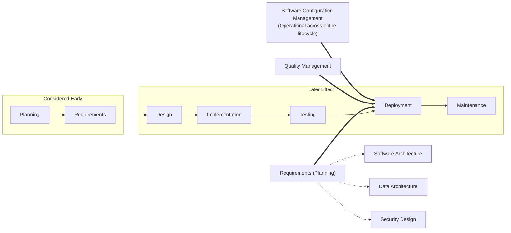
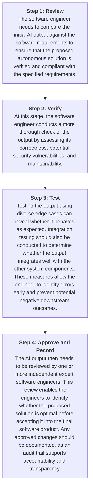

# SEN381 Assignment 1

**Team Members:**

- Tinyiko Siwele [601726]
- Mutshidzi Nduvheni [601781]
- Thabang Molise [601586]

---

## Software Engineering Beyond Programming

Software development cannot be considered successful simply because programmers produce functioning code; it also includes how engineers must first understand the problem being solved, who is affected by the system, what constraints exist, and how those requirements will influence the rest of the lifecycle. According to the Software Engineering Body of Knowledge (SWEBOK), software projects become increasingly prone to poor project outcomes when requirements do not adequately address stakeholder needs and constraints (Bourque and Fairley, 2014). Therefore, Software Engineering requires consideration of how stakeholder needs, scope, schedule, cost and resources, quality and engineering risk interact throughout the development process.

Understanding stakeholder needs is one of the first factors that influence the other project constraints. Requirements represent what stakeholders expect from the system, and failing to establish a clear understanding between stakeholders and developers can create uncertainty within the development team, further leading to project-performance risks that will negatively impact the outcome of the project (Jiang et al, 2009). The researchers further identify that requirements uncertainty is a major contributor to schedule slippages and cost overruns (Jiang, J.J., Klein, G., Wu, S.P.J. and Liang, T.P. 2009). If the requirements are unclear or misunderstood, developers may implement functionality that does not satisfy stakeholders, resulting in rework and additional resources being required later in the project.

Scope is another important Software Engineering concern because uncontrolled changes to the agreed scope can affect several other project constraints. An empirical investigation by Aizaz et al. (2020) found that factors contributing to scope creep were negatively associated with software project success. The study highlights that scope creep can contribute to compromised quality, schedule delays, increased costs, and reduced customer satisfaction.

The increase in scope affects the project schedule because additional functionality generally requires additional development and testing effort. Schedule is an important Software Engineering consideration due to the fact that project timelines cannot be created independently. Research into software project scheduling found that effective schedule estimation requires not only appropriate estimation techniques but also an understanding of project requirements, organisational practices, software experience, and project risk. All of these factors play a huge role in confirming your software development as successful (Verner et al., 2007).

Cost and resources are there for closely connected to both scope and schedule. The amount of functionality that needs to be delivered and the time available to deliver it influence the number and type of resources required. These resources can include developers, specialised skills, tools and infrastructure (Verner et al., 2007). Furthermore, reducing the available budget or resources without adjusting the scope or schedule can lead to additional pressure placed on the developers. This illustrates the trade-off between the constraints: a project cannot continuously increase its scope while maintaining the same resources, budget, and deadline without potentially increasing the risk of negatively affecting software quality.

Software quality includes characteristics that go beyond the basic functionality of software. The addition of certain quality aspects can significantly increase stakeholder satisfaction, further supporting the study done by researchers that functioning code alone does not necessarily mean that the resulting system is a successful software product (Bourque and Fairly, 2014). Therefore, when a project experiences an increase in scope or a reduction in its available time and resources, the system may consequently be delivered within its original schedule and budget but still fail to satisfy important stakeholder expectations because quality requirements were not adequately addressed.

Engineering risk connects all of these factors because changes or weaknesses in one constraint can increase uncertainty in the others. For example, unclear stakeholder requirements can result in an incorrect scope. An incorrect or expanding scope can produce unrealistic schedules and resource requirements, and pressure on time or resources can create quality compromises. Research by Smith et al. (2006) on software projects in South Africa identified unclear or misunderstood scope, schedule flaws, inadequate planning, lack of skilled personnel, and lack of user involvement among significant software-project risks. This demonstrates that engineering risk is not an isolated concern but can emerge from the interaction between stakeholder needs, scope, schedule, resources, and quality.

### Real World Consequence Example

A real-world example of an engineering decision eventually producing a significant benefit can be seen in Netflix's migration to cloud-based infrastructure. Netflix made the architectural decision to move away from its traditional data-centre infrastructure and adopt a cloud-native approach by choosing a cloud-native approach and rebuilding virtually all of its technology, moving from a monolithic application to hundreds of microservices. This required significant time and effort, but the trade-off was that it created substantial long-term benefits (Izrailevsky et al., 2016). This example demonstrates that Software Engineering decisions can create constraints in one stage of a project while producing significant benefits in the system's lifecycle.

---

## Thinking Ahead: Decisions Across the Software Lifecycle

### Six Significant Software Engineering Concerns

#### Data architecture

Data architecture and management refer to how a system's data is structured, stored, accessed, and maintained (FP Data Solutions Team, 2025). Data models should be considered during the architecture design phase because it provides a means of visualising data patterns, flows, and relationships (FP Data Solutions Team, 2025). Software engineers need to identify information regarding essential entities, expected integration requirements, and data volume to represent the data as objects and define relevant relationships (Sommerville, 2015). Data architecture guides design and implementation choices, which in turn affect later activities such as backend processes and maintenance (FP Data Solutions Team, 2025). If decisions regarding the data structure are postponed, inappropriate data may be delivered to end users, or the data may not be stored and managed effectively.

#### Quality Management

Software engineers need to make decisions in accordance with their quality management plan. These concerns are found in the non-functional requirements, which specify how well the system must perform. Quality assurance refers to the proactive, process-based approach to managing quality; therefore, these decisions should be considered during the requirements planning and early stages of architecture design (Kijas, 2025). For engineers to make sound decisions, they need to consider the organisation, such as policies and development procedures; the product, such as reliability and performance; and external factors, such as laws, ethics and safety regulations (Sommerville, 2015). Quality management influences all phases of operations and should be implemented throughout each stage of production. If quality considerations are postponed, additional time and financial resources may be required to address issues that emerge later in production (Kijas, 2025). Furthermore, non-compliance with legal requirements may result in penalties or fines.

#### Requirements

Having requirements defined eliminates uncertainties and improves software lifecycle outcomes. Software requirements refer to the needs and constraints expressed by stakeholders that are placed on a software product that contribute to the solution of a real-world problem (Bourque and Fairly, 2014). Requirements should be considered early because they solidify the need and constraints that software activities must satisfy, and this is done throughout the development, testing, acceptance, and maintenance because requirements must be continuously monitored and managed across the lifecycle (Bourque and Fairly, 2014). Information concerning stakeholder needs, business goals, domain constraints and system priorities is therefore required before important design and implementation decisions can be made. If requirements are postponed until implementation, developers may make architectural and design decisions based on incomplete information; this may cause misunderstandings amongst the developers, leading to unnecessary conflict, scope changes and rework which negatively affects the initial cost and schedule planned and potentially, an unsuitable product (Verner et al., 2007).

#### Software Configuration Management/Version Control Strategy

Software Configuration Management refers to the process of identifying and controlling the configuration of software at different points in time to systematically manage changes while maintaining the integrity and traceability of software artefacts throughout the software life cycle (Bourque and Fairley, 2014). Studies from IEEE 828 further establish configuration management processes for identifying configuration items, controlling changes, reporting configuration status, and managing builds and releases (IEEE, 2012). SCM therefore requires careful planning during the early phases of development before multiple developers begin modifying shared systems. Establishing a version control and configuration management strategy early enables development teams to track changes, maintain consistent versions, and support collaboration throughout development. However, delaying these decisions can make it difficult to determine which version of an artefact is correct, reproduce previous builds, and can increase integration problems. SCM activities remain relevant throughout the software lifecycle, particularly during the planning, testing, releases and maintenance (Bourque and Fairley, 2014).

#### Software Architecture

Software Architecture refers to the fundamental structures of a system, comprising its software elements, their relationships to one another and the environment, and the principles governing their design (Bass et al, 2021). Architectural decisions should be considered during the early design phase, since architecture is one of the core software engineering knowledge areas that must be addressed before implementation begins in earnest (Boruque and Fairley, 2014). To make sound architectural decisions, engineers require information on quality attribute priorities such as performance, security, and modifiability, the expected scale of the system, and constraints imposed by the organisation and any existing systems it must integrate with (Bass et all, 2021). Architecture guides technology selection, module boundaries, deployment topology, and the feasibility of later features; consequently, architectural inconsistencies that are expensive, or in some cases impossible, to correct without extensive rework (Bass et al, 2021)

#### Security by Design

Security by design refers to the practice of embedding security considerations into a system from its earliest design decisions, rather than adding protective measures after development is complete (McGraw, 2006). This concern should be considered from the requirements and design phases onward, since the National Institute of Standards and Technology (2022) recommends integrating security practices throughout the software development lifecycle rather than treating them as a separate final stage. Sound security decisions require information about the sensitivity of the data a system will handle, the threat landscape relevant to its users, and any applicable regulatory obligations (National Institute of Standards and Technology, 2022). Security decisions influence authentication design, data storage choices, and testing strategy across the lifecycle. McGraw (2006) observes that vulnerabilities introduced early but discovered late are markedly more expensive to correct; postponing security consideration until implementation therefore risks costly rework, unresolved vulnerabilities in the released product, and potential non-compliance with data protection obligations.

### Decision Horizontal Map

*Figure 1: Decision Horizontal Map (originally titled "Decision Horizon Map"). Requirements (Planning) branches into Software Architecture, Data Architecture and Security Design, and continues across the lifecycle. Quality Management and Software Configuration Management also run across the lifecycle.*

---

## Evidence-Based Technology Stack Decisions

### Stack Characteristics (Quick Brief)

#### MERN

MongoDB (a document/NoSQL database), Express.js (a minimal, unopinionated Node.js web framework), React (a frontend UI library), and Node.js (a JavaScript runtime built on an event-driven, non-blocking I/O model). The stack is deliberately decoupled; each layer is chosen and wired together by the development team, rather than prescribed by a single framework.

#### Django + React

Django (a "batteries-included" Python web framework following the Model-Template-View pattern, typically paired with Django Rest Framework to serve a decoupled React frontend), running against a relational database (commonly PostgreSQL) through Django's built-in ORM. Unlike MERN, Django ships with an opinionated project structure, an admin interface, an authentication system, and a security layer already assembled.

### Weighted Decision Matrix

#### Weights and their justification

| Criterion | Weight | Why this weight |
| --- | --- | --- |
| Security Ecosystem | 20% | Security is classified as a top-level product-quality characteristic (International Organization for Standardization, 2011), and security failures are typically the least recoverable from engineering failure. This criterion is weighted jointly the highest |
| Maintainability | 20% | Maintainability is treated as equally foundational to security under the same standard (International Organization for Standardization, 2011). A system that is inexpensive to build but costly to modify quickly loses this advantage. This criterion is weighted jointly highest with security. |
| Team Capability / Learning Curve | 15% | This represents a front-loaded cost that diminishes as team experience grows and is therefore weighted below the two lifecycle-spanning criteria above. |
| Testing and Tooling support | 15% | Testing infrastructure underpins the team's capacity for safe future change, overlapping conceptually with maintainability. It is weighted closely to maintainability but slightly lower to avoid double-counting the same underlying quality attribute. |
| Deployment / Platform compatibility | 10% | Both stacks are mature and broadly supported across major hosting platforms (Django Software Foundation, n.d); the practical risk of incompatibility is therefore low regardless of choice. |
| Development and Operational Cost | 10% | This criterion is weighted low deliberately. No independently verifiable cost data exists beyond vendor and agency marketing content, and a weakly evidenced criterion should not be permitted to influence the outcome disproportionately |
| Future change and maintainability implications | 10% | This criterion is inherently speculative at this stage, as forecasting a system's future direction is less certain than assessing its present, demonstrable capabilities. |
| **Total** | **100%** |  |

#### Scored Matrix (1 = weak, 5 = string)

| **Criterion** | **Weight** | **MERN score** | **MERN weighted** | **Django + React score** | **Django + React weighted** |
| --- | --- | --- | --- | --- | --- |
| Team Capability / Learning Curve | 15% | 4 | 0.60 | 3 | 0.45 |
| Security Ecosystem | 20% | 3 | 0.60 | 5 | 1.00 |
| Maintainability | 20% | 3 | 0.60 | 4 | 0.80 |
| Testing and tooling support | 15% | 3 | 0.45 | 5 | 0.75 |
| Deployment / Platform compatibility | 10% | 4 | 0.40 | 4 | 0.40 |
| Development and operation Cost | 10% | 3 | 0.30 | 3 | 0.30 |
| Future change implications | 10% | 4 | 0.40 | 4 | 0.40 |
| **Weighted total (/5)** |  |  | **3.35** |  | **4.10** |

#### Limitations of the Matrix

A weighted decision matrix produces a single number, which may appear more objective than it is in practice. Four limitations should be noted.

The cost criterion rests on weak evidence. No independently verifiable, methodologically transparent comparison of hosting or development costs between the two stacks could be located; only vendor pricing pages and agency marketing content with unsourced figures were found. Rather than omitting the criterion or fabricating a distinction, it was scored using measured resource consumption as a proxy (Carmo et al, 2024) and weighted at only 10 per cent because of this evidence gap. The cost row should therefore be regarded as the least reliable in the matrix.

The weights encode a specific set of priorities rather than a universal standard. Weighting security and maintainability jointly highest reflects an assumption that the hypothetical information system handles user data and must remain viable across multiple years of change. This is a reasonable assumption for a modern web-based information system in general, though not the only reasonable one. A team building a short-lived prototype, or a system without persistent user data, could legitimately weight learning curve or deployment speed more highly, which would affect the outcome.

The evidence represents a snapshot in time. The figures drawn from the Stack Overflow Developer Survey (2025) reflect a single year's respondents; framework adoption and language popularity shift annually, so a matrix constructed in a subsequent year might score team capability differently even where the frameworks themselves are unchanged

A five-point ordinal scale compresses meaningful differences. Two criteria scored identically for the same stack are not necessarily equivalent in practice; the scale reduces continuous, multi-dimensional characteristics to a single digit for comparability. The scores in section 3.2 should therefore be read alongside their justifications rather than treated as precise measurements

### Critical Question: Why the Highest-Scoring Stack Is Not Automatically Correct for Every Project

The matrix scores Django with React higher overall (4.10 vs 3.35); however, this outcome holds only under the weights adopted in this analysis. The advantage derives almost entirely from two criteria, security and testing, where Django's included-by-default design has a directly citable edge (Django Software Foundation, n.d.a; OWASP, n.d.a). Removing these two criteria leaves the stacks close to level. A weighted matrix does not discover an objectively superior technology; it mechanically produces whatever the chosen weights imply, meaning the result is only as sound as the reasoning underlying those weights.

Popularity illustrates the same principle from the opposite direction. By raw adoption, MERN is more popular than Django with React (Stack Overflow, 2025), yet it scores lower in this matrix, because popularity was not among the seven required criteria. It functions, at best, as a weak proxy for team capability, and has no bearing on what a framework's security or testing infrastructure provides.

Both observations trace to a single cause: the weights assume a generic project holding persistent user data across multiple years of change. A project with different constraints, such as different data sensitivity, concurrency requirements, or an already-established team skillset, would reasonably reweight the same evidence and could reverse the outcome. This is precisely why the assignment brief separates this exercise from an actual CivicConnect decision: prior to real constraints being known, the purpose of a matrix of this kind is to render trade-offs explicit and evidenced, not to produce a verdict.

### Narrative Comparison

The matrix quantifies the comparison; this section presents the same reasoning in prose.

#### Team capability and learning curve

MERN's single-language stack and larger current adoption provide a larger available skills pool (Stack Overflow, 2025). Django's advantage is structured rather than linguistic, reducing the number of architectural decisions required once Python is known.

#### Security and Testing

Django provides both protections and testing tools active by default, whereas Node.js and Express assemble both from third-party modules (Django Software Foundations, n.d; Encode OSS, n.d; OWASP, n.d; Jest, n.d). Django's included-by-default design is the direct source of its advantage on both criteria.

#### Maintainability

The same design philosophy operates in the opposite direction for flexibility. Django's structure reduces long-term maintenance burden for a team without established conventions of its own, while Express's minimalism maximises freedom at the cost of additional architectural decisions (Sahai et al, 2025).

#### Deployment and Platform Compatibility

Both stacks are mature and broadly supported (Django Software Foundation, n.d; Express.js, n.d). Node.js is asynchronous by design, whereas Django's ASGI support was added subsequently, a distinction relevant mainly to systems with substantial real-time concurrency requirements.

#### Cost and Future Change

Both remain the least certain criteria. The strongest available evidence found Node.js and Django REST Framework performing similarly under equivalent load (Carno eta l, 2024), and accordingly no confident cost distinction is drawn. Regarding future change, JavaScript's continued dominance favours MERN's hiring pool, while Python's faster growth favours Django should scope expand toward artificial-intelligence or data-driven work (Stack Overflow, 2025); this represents a genuine trade-off rather than a clear advantage in either direction.

---

## Responsible AI in Software Engineering

### Valuable Uses and Risks associated with AI-assisted engineering

The advantages and disadvantages of generative Artificial Intelligence (AI) used across software engineering activities are identified and explained in the table below:

| *Benefits* | *Limitations* |
| --- | --- |
| Generative AI allows for faster development because it helps developers automate coding tasks (Aguilar-López et al., 2025). These tasks can become repetitive and time-consuming, so having a tool that generates code snippets from natural language prompts can improve coding efficiency (Aguilar-López et al., 2025). | AI hallucinations are instances where an AI system generates false and misleading outputs that appear plausible (China, 2023). This flaw can frustrate developers if the AI suggests non-existent functions or features (Aguilar-López et al., 2025). |
| Self-generated test cases assist software engineers during the testing phase of product development (Cornide-Reyes et al., 2025). AI improves test coverage by generating more diverse and adaptive test cases that teams might not have considered, allowing for more thorough testing (Westfield, 2025; Finio and Downie, 2024). | The black box nature of an AI model implies that the logic behind the decisions it makes is hidden (Abbas et al., 2025). This means that reviewing AI-generated code becomes more tedious. Research states that 30%–50% of developers complain that debugging AI-written code is difficult because of the lack of clarity in its reasoning or decision-making (Abbas et al., 2025). |
| AI, in collaboration with human ideas, can transform them into requirements and generate clear user stories (Finio and Downie, 2024). This suggests that engineers can focus more on creative ideation rather than being concerned with the documentation required during the planning process. | Overreliance on AI recommendations can lead to misguided decisions (Millawati, 2023). This applies to all activities in software engineering; therefore, critical analysis of and an understanding of AI's limitations is crucial for making informed choices (Millawati, 2023). |

### Human Verification and Control Process

Human-in-the-loop refers to the process of human judgement being embedded in automated workflows and supervising AI workflows (Stryker, 2025). The steps for a human verification/ control process are shown in the diagram below:

*Figure 2: Human Verification Process Steps*

### AI Accountability

AI should be used as an assistant when making engineering decisions and not be heavily relied on (Millawati, 2023). This is true because AI may generate code that contains incorrect assumptions or hallucinations (Aguilar-López et al., 2025; China, 2023). The engineer is still responsible for reviewing, testing, and validating the output so it aligns with activity requirements. This way, the engineer will be able to spot any vulnerabilities that occur. The AI system cannot be held accountable because it has no duty to act in good faith and correctness (Ahmed, Allen and Shai, 2026). Therefore, the engineer needs to take full responsibility for failure to exercise appropriate judgement.

---

## AI Research & Verification Record

| *Team Member* | *AI tool/ use* | *Purpose* | *Output used?* | *How independently verified* | *What was changed/rejected* |
| --- | --- | --- | --- | --- | --- |
| Tinyiko Siwele | ChatGPT | Proofreading and grammatical construction | Minor | Completely verified | "creatively ideating" → "creative ideation"; "with planning" → "during the planning process"; "rather than worrying about" → "rather than being concerned with"; "critical analysis and understanding" → "critical analysis of and an understanding of"; "choice making" → "making informed choices"; "quicker development time" → "faster development"; "output" → "outputs that appear plausible"; "choices" → "decision-making"; "formulate decisions" → "make decisions in accordance with"; "time and money will be lost due to issues later" → "additional time and financial resources may be required to address issues that emerge later"; "if clear data structure decisions" → "If decisions regarding the data structure"; |
| Mutshidzi Nduvheni | ChatGPT Perplexity | Proofreading, grammatical errors, assistance with visualization map Assistance with article sourcing and summarizing articles | Moderate Minor | Completely Verified Completely Verified | AI-generated wording was edited to fit my own understanding. Incorrect citation details were rejected or updated. N/A |
| Thabang Molise | Claude Gemini | Article sourcing Proofreading and grammatical error correcting | Minor Moderate | Completely verified Completely verified | 5 sources out of the original batch of 15 were rejected; they were categorized as blogs, newsletters, and personal briefs, which were uncreditable |

---
