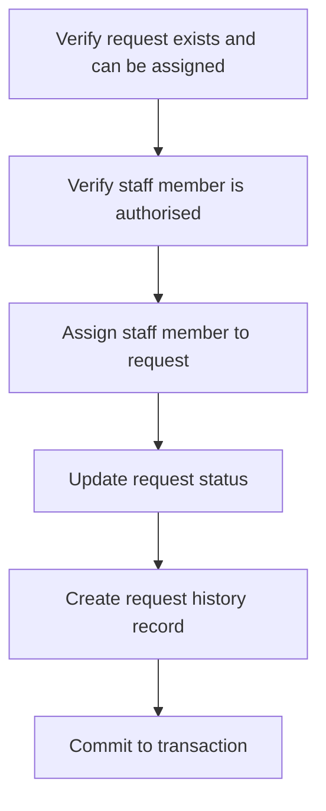

# SEN381 Assignment 2

**Team Members:**

- Tinyiko Siwele [601726]
- Mutshidzi Nduvheni [601781]
- Thabang Molise [601586]

---

## Task 1 - Researching Design Quality and Design Patterns

### Establish The Design Problem

#### Coupling and Cohesion

Coupling describes the degree of interdependence between software modules, while cohesion describes how closely the elements within a single module belong together (Sommerville, 2015). High coupling implies a change in one module tends to force changes in others, while low cohesion implies a module is doing unrelated tasks, which makes it harder to understand, test, and reuse in isolation (Sommerville, 2015). As CivicConnect moves from documented requirements into actual implementation, the way responsibilities are distributed across classes, will now determine how expensive future changes are, since poorly structured code accumulates design debt that alter work must pay down (Fowler, 2018).

#### Relevant SOLID Principles

Not all five SOLID principles contributed equally to the problems below. The two most relevant are the Single Responsibility Principle (SRP), that a class should have only one reason to change, and the Open/Closed Principle (OCP), that software entities should be open for extension but closed for modification (Martin, 2003). The Dependency Inversion Principle (DIP), that high-level modules should depend on abstractions rather than concrete low-level modules, is also directly relevant to Design Problem 1 below (Martin, 2003).

#### Design Problem 1: Notification logic entangled with request handling

When a service request changes status, CivicConnect must notify the requester by email (FR-006). In a naive implementation, the same code responsible for creating and updating a request record would also be responsible for constructing and sending that notification, meaning the request-handling logic carries two unrelated responsibilities: managing the request's own state, and knowing the mechanics of a specific notification channel. SMS/WhatsApp notification is currently a deferred, unconfirmed future channel. If it is later confirmed, a tightly coupled implementation would require modifying the same request-handling code again, and every additional channel increases the risk of these two concerns becoming further entangled. This is a coupling and single-responsibility problem: request-handling logic is tightly bound to one specific, current notification mechanism.

#### Design Problem 2: Status transition rules scattered across the system.

CivicConnect requirements state that a request's status must move through a controlled, forward-only sequence (FR-011), that certain transitions are staff-only (FR-010), and that the system must auto-generate an "Overdue" status once the due date passes (FR-012). If one rule for "which transitions are valid from the current status" is implemented as conditional logic spread across the UI, the request-handling service, and staff/admin views, the same business rule ends up duplicated in multiple places. Any future change to the status lifecycle, such as adding a new status or an approval step, would require finding and correctly updating every duplicate, which is exactly the kind of problem the Open/Closed Principle is intended to address (Martin, 2003)

### Research alternatives for each problem

#### Problem 1 Alternatives: Strategy-based notifier interface vs. Observer pattern

**Option A: Strategy-based Notifier Interface**

A Notifier interface is defined with a single method, for example, send (request, event). The request-handling service depends on this interface rather than a concrete implementation, and a concrete EmailNotifier class implementing it is injected at runtime (Gamma et al., 1994; Martin, 2003). This decouples request logic from the concrete notification mechanism, satisfying DIP and testability, since a fake or mock notifier can be substituted in unit tests without sending real email. Cohesion improves because the request service no longer needs to know email-specific details. The main risk is that if the number of independent, and/or differently triggered notification behaviours grows substantially, a single interface swapped out at injection time becomes less natural than a true publish/subscribe relationship, and the team may end up re-implementing observer-like registration manually anyway.

**Option B: Observer pattern**

The request object acts as a subject that maintains a list of observer objects and notifies all of them whenever its state changes; each concrete observer, such as EmailObserver and later a possible SMSObserver, independently decides how to react (Gamma et al., 1994). This gives strong extensibility, since adding a new channel means adding a new observer class with no change to the request object itself, directly satisfying OCP (Martin, 2003). The risk is that it introduces subject/observer registration machinery and added indirection, which can make it harder to trace what happens on a status change. For a system that currently has exactly one active channel, with the second explicitly deferred and unconfirmed, this is meaningful complexity with no current payoff, a recognised over-engineering risk associated with applying a pattern ahead of the vulnerability it is meant to support (Fowler, 2018).

**Comparison**: Observer is the recommended choice once multiple independent notification channels are genuinely confirmed and need to react differently to the same event. For CivicConnect's current baseline, which has one active channel and one explicitly deferred channel with no confirmed requirement, the more efficient dependency-injected Notifier interface satisfies DIP and testability now, without paying for extensibility the project does not yet need.

#### Problem 2 Alternatives: Table-driven transition validation vs. State pattern

**Option A: Table-driven Transition Validation**

A single, centralised structure, such as a map of current status to the set of allowed next statuses, is consulted by one transition-validation function before any status change is committed. This function becomes the only place that "knows" the lifecycle rule, consistent with modelling system behaviour through explicit state-based models (Sommerville, 2015). This keeps a single source of truth for the rule described in FR-011, and satisfies OCP reasonably well for a small, largely linear set of statuses (Submitted, Assigned, In Progress, Resolved, Closed, Overdue), since adding a new status means adding table entries rather than editing conditional logic spread across the codebase. The risk is that if individual statuses ever need genuinely different behaviour, not just different allowed next states, the table approach provides nowhere natural to place that logic, and extra conditional code tends to grow alongside the table regardless.

**Option B: State Pattern**

Each status becomes its own class implementing a common `State` interface; the request object delegates behaviour to its current state object, and each state class knows which transitions it allows and what should happen on entry or exit (Gamma et al., 1994). This gives strong extensibility and OCP compliance when different statuses genuinely need different behaviour, not just different allowed next states (Martin, 2003). The risk is that for a small, fixed set of statuses whose real difference is which transitions are valid, a class-per-status structure is more machinery than the problem currently needs, a form of over-engineering that introduces structural complexity ahead of a genuine behavioural need (Fowler, 2018).

**Comparison**: the State pattern is the stronger choice if later requirements introduce status-specific behaviour beyond "which transition is next," such as different validation or side effects per status. Since CivicConnect's current requirements describe the problem purely in terms of allowed transitions (FR-011) and one triggered override (FR-012), the simpler table-driven validator addresses the actual problem without the added class structure, while remaining straightforward to refactor into the State pattern later if genuine per-status behavioural differences emerge.

### CivicConnect Recommendation

#### Design Problem 1 (Notification Coupling)

The team recommends a dependency-injected Notifier interface (Option A) as input to the M2 design decision, rather than the observer pattern, because CivicConnect's confirmed scope has one active notification channel with a second explicitly deferred pending stakeholder confirmation. This keeps the request-handling service decoupled and independently testable, satisfies SRP and DIP, and does not foreclose a later move to Observer if a second channel is confirmed and needs independent reactive behaviour.

#### Design Problem 2 (Status Transition Logic)

The team recommends a table-driven validator (Option A) as input to the M2 design decision, rather than the state pattern, because the current requirement set describes the problem purely as which transitions are valid, with no stated behavioural difference between statuses beyond that. This keeps the lifecycle rule in one place, satisfying OCP for the realistic scope of change, namely adding new statuses, without introducing a class per status ahead of a genuine need.

---

## Task 2 - Researching Persistence and Data-Integrity Decisions

### Choose one meaningful business operation

### Engineering choices

When a request is assigned, multiple pieces of information may need to be changed, including when the request needs to store the assigned staff member, updating its status, and creating a corresponding request history. This operation is important because an incorrect/incomplete update could leave CivicConnect with inconsistent information. In certain instances, a request could be assigned to a staff member while that event was not recorded. This neglects data integrity and reliability of the request monitoring and management dashboard.

#### Transaction/Atomicity requirements

Atomicity establishes an "all-or-nothing" operation, and what this means in the context of data integrity is to either commit every single change included in the transaction or nothing is changed at all (Cai, 2020). For CivicConnect, the operation should therefore:

If an error persists before the transaction is committed, the changes can be rolled back rather than leaving only some of the changes in the database.

#### Enforcement of validation and business rules

| Layer | Responsibility | Example |
| --- | --- | --- |
| UI/Client (Front-end) | User feedback/basic validation | Ensure a staff member has been selected |
| Application/service (Backend) | Business-rule validation | Check that the staff member is authorised and that the request can be assigned (Lozano et al, 2011). |
| Database | Data-integrity enforcement | Primary and Foreign keys, required fields, and uniqueness constraints (Lozano et al, 2011). |

#### Consistency, concurrency/integrity mechanisms

Concurrency control is important when transactions access shared database data concurrently. Ketsman et al. (2023) explain that concurrency control balances the benefits of concurrent access with the need to maintain data consistency, as concurrent transactions can result in data anomalies. In CivicConnect, this could occur when two staff members attempt to update or assign the same service request at the same time. Therefore, appropriate concurrency-control mechanisms can help prevent conflicting updates and maintain data consistency (Ketsman et al., 2023).

Data consistency refers to the degree in which data is absent of contradiction and similar with other data in the same context across all systems and database (Wang et al, 2023). Data consistency is important due to a service request may involve multiple related pieces of information, such as its assigned staff member, current status and request history. If one of these pieces of information is updated while another fails to update, the system could contain conflicting information.

Integrity constraints can be used to prevent invalid data and relationships from being stored (Cawthra et al., 2020). In Civic Connect, database constraints could be used to protect important relationships, such as ensuring that an assigned staff member exists in the staff records and that required information cannot be left empty, providing an additional level of protection and consistency.

#### Performance feature

Caching could potentially be a benefit for the CivicConnect management dashbaord which may improve performance by reducing repeated database queries for frequently viewed statistics, such as open, resolved and overdue requests. However, caching does create trade-off between performance and data freshness as cached data can possibly become stale when requests are updated.

#### Plausible Implementation Approaches

|  | Application-centered | Layered Approach |
| --- | --- | --- |
| Description | Most validation and business rules are handled in the backend/application layer before data is saved | Validation is shared between the frontend, backend and database, with each layer handling appropriate checks. |
| Pros | Centralises business logic Provides the application more control over rules | Provides multiple levels of protection Reduces chance of invalid data entering the database |
| Cons | If another application accesses the database directly, it may bypass some rules | More effort is required on development, as rules must be considered among multiple layers |

### CivicConnect Recommendation

For CivicConnect, the Request Assignment operation should preserve correctness by ensuring that when assigning a request to a staff member, updating the request status, and recording the corresponding history/audit information are handled as one transaction. The frontend should perform basic input validation, the backend will enforce business rules such as whether the staff member is authorised and whether the request can be assigned, and the database should enforce fundamental integrity constraints such as valid foreign-key relationships.

The M2 persistence decision should include transactional request updates with layered validation and database integrity constraints. This recommendation should inform the data model, an ADR documenting the persistence/validation approach, the risk register for inconsistent or partial request updates, and the implementation artefact responsible for the request assessment.

---

## Task 3 - Researching APIs and Integration Decisions

### Identify an integration problem

An integration problem that CivicConnect could face is the interaction between the frontend and backend when a requester submits a service request. The frontend produces the information (the request description, category, location, etc) to the backend. The backend then consumes that information and processes it. After processing the information, the backend should return response to the frontend indicating whether the request was successfully processed alongside its relevant information or an error message.

This integration requires an explicit engineering decision due to failure or incorrect communication between the frontend and backend could result in a request not being created, incorrect information being stored, or the user who sent out the request will be uncertain about whether their request was successfully submitted/received.

### Compare integration approaches

#### Approach 1: In-Process Interface

The frontend and backend communicate through internal application interfaces without a network/API boundary. This approach can reduce communication overhead and simplify deployment because the components operate together (Blinowski et al., 2022). However, this approach can create tighter coupling between the components, making independent development, testing and deployment more difficult (Auer et al., 2021).

#### Approach 2: HTTP/REST API

HTTP/REST API communication provides a defined interface between and the backend. The frontend can send an HTTP request containing the service-request information, while the backend processes the request and returns an appropriate response (Antonio et al., 2021). This also creates a clearer separation between the components and can support independent development and testing (Shafiee et al., 2020). However, it introduces additional considerations such as network failures, latency, API security and compatibility between frontend and backend versions (Tanveer et al., 2025). Research on software integration also identifies REST-based architectures as an approach commonly used to achieve looser coupling between software units (Ruiz Ceniceros et al., 2021).

| Factor | In-Process Communication | HTTP/REST API |
| --- | --- | --- |
| Coupling | Tighter coupling between components | Lower coupling through (Karabey Aksakalli *et al.*, 2021) |
| Performance | Lower communication overhead | Network communication introduces (Karabey Aksakalli *et al.*, 2021) |
| Failure handling | Fewer network-related | Must handle network/API failures (Karabey Aksakalli *et al.*, 2021) |
| Testing | Simpler within one application | Frontend and backend can be tested separately (Karabey Aksakalli *et al.*, 2021) |
| Deployment | Components are more closely tied together | Components can potentially be deployed independently (Karabey Aksakalli *et al.*, 2021) |
| Security | Similar communication boundary | Requires secure API communication and authentication (Berardi *et al.*, 2022 |
| Compatibility | Fewer API-version concerns | API contracts and compatibility must be managed (Karabey Aksakalli *et al.*, 2021) |

#### REST Principles

Rest uses a client-server approach and staleless communication, where each request contains the information needed to process it. For CivicConnect, REST resources could include requests, users and categories, with HTTP methods such as GET for retrieving data and POST for creating requests.

HTTP status codes communicate the result of an operation. For example, "201 Created" indicates a successful request submission, while 4xx codes indicate client errors and 5xx codes indicate server errors (Fielding et al., 2022). Error responses should therefore provide enough information for the frontend to handle failures appropriately.

#### Cost of Distribution

Using REST creates a network boundary between the frontend and backend. This can introduce latency, network failures, security requirements and API compatibility concerns (Karabey Aksakalli *et al.*, 2021). However, this boundary is justified in CivicConnect because it separates the frontend from the backend and from the backend and provides a controlled interface for communication.

REST should not be used for every internal operation. Backend components that operate within the same application can communicate directly to avoid unnecessary network overhead and failure points.

### CivicConnect Recommendation

For CivicConnect, HTTP/REST should be used for communication between the frontend and backend because this represents a meaningful component boundary requiring a defined interface. The API should use resources, appropriate HTTP methods, meaningful status codes, structured error responses and stateless communication. However, REST should not be introduced for every internal interaction because a network boundary creates additional latency, failure conditions and security considerations. Internal backend operations should therefor use simpler in-process communication where a distributed boundary is not required.

---

## Task 4 - Researching Collaborative Engineering and CI Controls

### SCM and collaborative integration

#### SCM vs VCS

Software configuration management (SCM) is the discipline of managing the evolution of software systems by controlling changes throughout the lifecycle of all software artifacts (IEEE Computer Society, 2008). SCM is a broader approach that includes version control as a function (Bhardwaj, 2020). A version control system (VCS) is responsible for tracking changes in a document and allows simultaneous collaboration (Coursera Staff, 2026). Each person working on the shared document can store their changes in a branch, or an isolated workspace; then propose to integrate their changes, or create a pull request, back into the main document (Coursera Staff, 2026; Caballar and Stryker, 2026). A VCS also allows teams to view revision history, rollbacks, and team reviews (Coursera Staff, 2026).

#### Review and Traceability Practices

A feature branch or web services workflow assumes a central main branch, and developers create new branches every time they begin to work on a new feature (GitLab, 2026; Atlassian, 2019). Feature branches should have descriptive names and have a highly focused purpose (Atlassian, 2019). Linking the branch creation to a requirement from the planning phase is another way to practice traceability (GitLab, 2026). When a feature is complete, the work is merged into the main branch after peer review. Longer-lived feature branches may need to periodically merge in the latest updates from main during its development (GitLab, 2026).

Additionally, another practice states that the main branch should be protected to prevent uncontrolled changes (GitLab, 2026; Atlassian, 2019). Peer review (or pull request reviews) allows team members to comment on changes, suggest improvements, and approve or request changes before a feature branch is merged into main (GitLab, 2026). This workflow assumes the main branch is treated as the canonical production branch and that the team is not actively maintaining previous versions of the system (GitLab, 2026).

#### Project Risk Management

| Constraint | Proposed Solution | CivicConnect Risk | Proposed Mitigation Strategy |
| --- | --- | --- | --- |
| Protected main branch | Direct pushes shall be disabled in the workflow (GitHub, 2026). This protects the main branch from accidental merges or uncontrolled changes | Pushes into the main branch may be bypassed if the protection rules are not configured correctly. | Configure the branch protection rules to require pull requests containing at least two peer reviews (GitHub, 2026). Restrict who is allowed to modify and bypass protection rules (GitHub, 2026). Any silent or unapproved changes may be traced back to the person responsible. |
| Minimum of two reviewers | Pull requests made to the main branch shall only be merged after the approval of two developers. | Two developers reviewing the changes does not guarantee that the work has been critically evaluated. | To avoid mechanical reviews, pull requests need to be kept concise because it is easier to review smaller changes than large ones (GitHub, 2026). Reviewers shall provide comments on the requested changes made (such as alternatives or approval). This creates evidence that the review happened. Reviewers should have a pull request checklist that gives specific categories to evaluate (such as functionality, test coverage, and security) (Sood, 2025). |

### Continuous Integration and quality gates

Continuous Integration (CI) is a software engineering process where developers frequently merge their changes back into the main branch (Pittet, 2019). It includes sub-practices such as frequent commits and builds, automated tests, and immediately fixing broken builds (Soares et al., 2022). Git is simply a tool used to apply continuous integration practices. Continuous Delivery (CD) is an extension of CI since it automatically deploys changes to a testing environment after the build stage (Pittet, 2019).

#### CI Triggers and Repeatable Builds

CI triggers cause a pipeline to run whenever an update has been pushed to a specified branch(es) (Microsoft, 2024). Possible events that can trigger a workflow include when branch protection rules are changed, when a git branch is created or deleted, and when someone has forked or downloaded a local copy of the repository (GitHub, 2026).

Reproducible builds are builds that give the same output no matter where they are run, meaning the build should produce the same output when repeated (Black, 2022). The table below shows sources that support repeatable builds for the React, Node.js/Express and PostgreSQL stack:

|  | Repeatable build requirement(s) |
| --- | --- |
| React | Create a .env file |
| Node.js/Express | A fixed Node.js version. Lock dependencies (package-lock.json) that describe the exact dependencies used in the system, so the installations are reproducible. Use the command 'npm ci' to cleanly install dependencies in automated environments. (npm, 2025) |
| PostgreSQL | To run tests that require access to a database, service or Docker containers may be used. They provide a portable way to host services. (GitHub, 2026) |

*The chosen stack shown does not reflect the final stack that will be used for CivicConnect.

#### Automated Checks

| Automated check | What it verifies | CivicConnect CI example | Type of check (block/ warning) |
| --- | --- | --- | --- |
| Build /compilation | The compilation of the application is successful | `npm run build` | Blocks integration because the application cannot be deployed if it cannot build. |
| Unit tests | Components individually run as expected | `npm test` | Blocks integration because expected behaviours are no longer verified and functionality may be lost. |
| Lint/ static analysis | Checks source code for programmatic and stylistic errors (Saladino, 2024). | `npm run lint` | Warns integration because formatting or maintainability issues are not inherently functional failures. |
| Dependency/ security audit | Reports any known vulnerabilities of the dependencies configured (npm, 2025). | `npm audit` | Blocks integration for only critical dependency vulnerabilities. Blocking low vulnerabilities may create unnecessary noise. |
| API/ Integration tests | Technology stack and layers work together. Correct API behaviour. | API test suite (e.g. results of a POST method) | Blocks integration because the technology stack should work together as a unified system. Failures indicate broken system boundaries. |

#### Configuration Handling and Automation Accountability

An environment file stores configuration values such as API keys, database credentials, or any application secrets (Rose et al., 2020). These values should be stored in CI secret storage rather than being hard-coded into the source code to prevent security compromises. Reviewers should be able to view CI results directly on the pull request instead of checking an external system. Furthermore, automation and CI results alone should not replace peer review because automated checks are unable to recognise if the solution meets the requirements. Automated CI checks whether the application runs when a change is made, but human reviewers check why the change was designed that way. Full accountability belongs to the engineers making the system.

### CivicConnect Recommendation

For CivicConnect, a controlled GitHub-based integration and CI process is recommended. Firstly, the developer will create a short-lived feature branch from the protected main branch and request to integrate their changes (create a pull request). Then the automated CI will run all the necessary checks (such as build, security, and API integration). The results of all the tests will be recorded on the pull request, ready for review. Two reviewers are required to inspect the changes and provide meaningful feedback. If the changes are unapproved, the developer who made the change revises their work, and the CI process repeats. After the approval of both reviewers, the changes may be safely merged into the main branch. This process should be done continuously throughout the project lifecycle.

---

## Task 5 - Research-to-Decision Map

| A2 Finding | Evidence/ alternative considered | Recommendation | Project decision it should inform | Expected PED/ADR/RTM/application evidence |
| --- | --- | --- | --- | --- |
| Design problem 1 | Two alternatives compared: dependency-injected Notifier interface vs. Observer pattern (Gamma et al., 1994); Martin, 2003) | DI-based Notifier interface (simpler, satisfies DIP/SRP now; Observer deferred until a second channel is confirmed) | M2 design decision: notification handling architecture | ADR recording the notifier design choice; RTM link to FR-006; application evidence = Notifier interface + EmailNotifier class in source |
| Design problem 2 | Two alternatives compared: table-driven transition validator vs. State pattern (Gamma et al., 1994; Martin, 2003) | Table-driven transition validator (single source of truth; sufficient for a small, fixed state set) | M2 data/persistence baseline | ADR on data-integrity approach; relevant NFR/risk entry: application evidence = the actual transition/validation code |
| Persistence/ data | Two approaches compared: Application-centered vs Layered approach | Layered approach (frontend performs basic validation; backend enforces business rules; database enforces integrity constraints) | M2 data/ persistence baseline | Data model, ADR on persistence/ validation approach; Risk register for partial updates; FR-008 and FR-010 (request assignment requirements); application evidence = schema and migrations, backend and frontend validation, database integration tests |
| Integration/API | Two approaches compared: In-Process Communication vs HTTP/REST API (Antonio et al., 2021; Blinowski et al., 2022; Auer et al., 2021) | HTTP/REST API (meaningful component boundaries; structured status codes and errors; stateless communication) | M2 integration/ API baseline | ADR recording API architecture; RTM links to relevant API-facing requirements; API contract; application evidence = routes/ controllers and integration API tests |
| SCM/CI | Direct integration to main branch vs protected main branch with peer review | Protected main branch with peer review (feature branches, automated CI pipelines, 2 reviewers) | M2 SCM/CI baseline | PED on PR workflow; RTM links CI checks to relevant quality requirements; application evidence = protected main, branch rules, CI results, PR review history, repeatable dependencies |

---

## AI Research & Verification Record

| *Team Member* | *AI tool/ use* | *Purpose* | *Output used?* | *How independently verified* | *What was changed/rejected* |
| --- | --- | --- | --- | --- | --- |
| Tinyiko Siwele | ChatGPT Gemini AI | Possible examples of traceability practices; quality control reviewer examples; automated check table Rephrasing | None used; suggestions were not backed by credible evidence Partially | Verified Verified | n/a "workflow allows the main branch to be configured to not allow direct pushes" -> "direct pushes shall be disabled in the workflow, and bypasses shall be prevented" |
| Mutshidzi Nduvheni | Chat GPT Perplexity | Rephrasing Providing and summarizing sources that may help with my research Verified the sources I received from ChatGPT and provided extra sources that could possibly help with my research | Partially Partially Partially | Verified Partially Verified Completely independently Verified | Wording and sentence structure within Task 2 and Task 3 Sources that did not help with my research or invalid as the AI did produce false sources. Provided academically credited sources and also indicated whether the source I had was valid or not |
| Thabang Molise | ChatGPT | Grammer and formal tone checking | partially | verified | Certain subject phrasing regarding SOLID principles was not accurately articulated in regards with class material associated with SOLID principles. |

---
